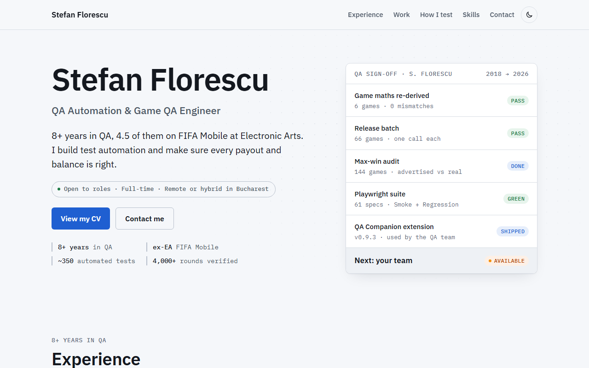
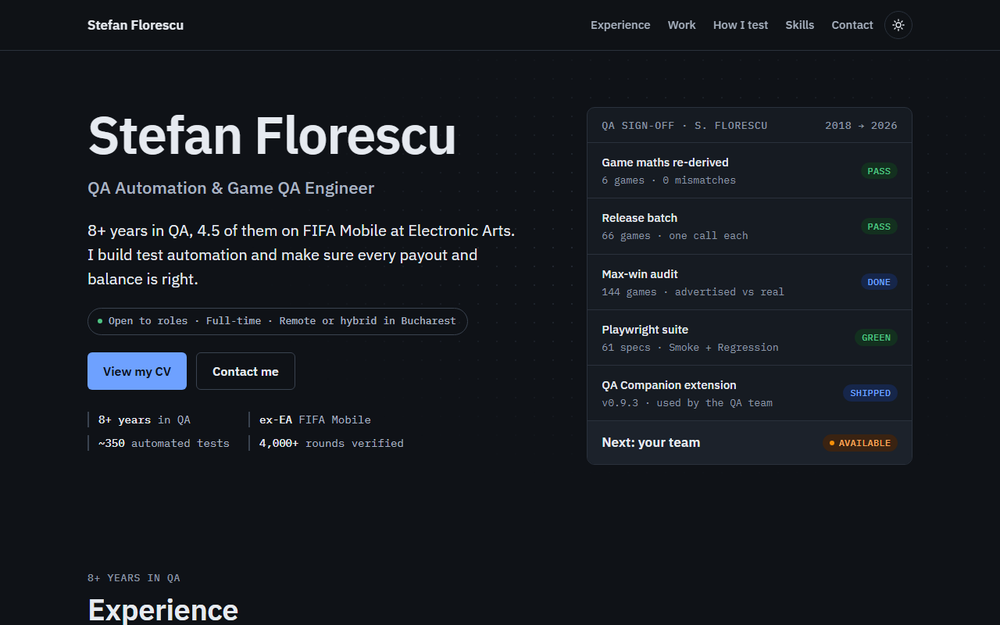
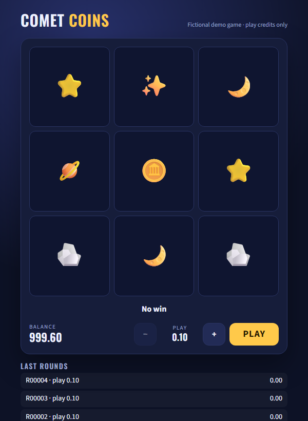
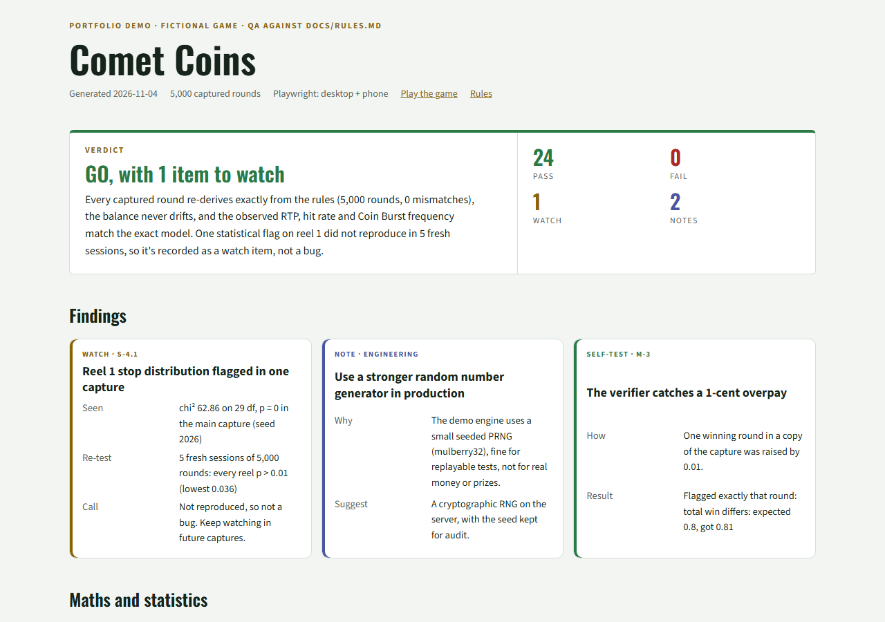

# QA portfolio: testing a game end to end

**Stefan Florescu · QA Automation & Game QA Engineer** · 8+ years in QA (ex-Electronic Arts, FIFA Mobile)

> I make sure games do exactly what they promise.

My client work is confidential, so this repo rebuilds **my testing method** on a small fictional game, **Comet Coins**. It goes from the rules document to a GO / NO-GO report. Everything runs locally, and all data is invented.

**Live site:** [https://stflorescu.github.io/qa-portfolio/](https://stflorescu.github.io/qa-portfolio/) · **CV:** [EN](cv/index.html) / [RO](cv/ro.html) (PDF: [EN](cv/Stefan_Florescu_CV_EN.pdf), [RO](cv/Stefan_Florescu_CV_RO.pdf)) · **Sample report:** [`report/index.html`](report/index.html) · **Play:** [`game/index.html`](game/index.html)

<p> </p>

## What's inside

| Step | What | Where |
|---|---|---|
| 1. Spec | The game's rules, treated as the source of truth. Every claim becomes a check. | [`docs/RULES.md`](docs/RULES.md) |
| 2. Game | A small instant game (engine = "server", page = client). | [`game/`](game/) |
| 3. Maths | **Independent verifier** written from the rules, not the game code. It re-derives every round (lines, wilds, scatter, cap, rounding, balance chain) and catches a planted 1-cent overpay. | [`tools/verify.js`](tools/verify.js) |
| 4. Statistics | **Exact model** from all 27,000 stop combinations (RTP 94.781%), then z-scores and chi-square on a 5,000-round capture. Flags are re-tested before they're called bugs. | [`tools/stats.js`](tools/stats.js) |
| 5. Behaviour | **Playwright** suite, 16 tests on desktop + phone: limits, locked controls, balance after every round, low funds, history, banned wording. A planted UI bug makes exactly one test fail. | [`tests/`](tests/) |
| 6. Decision | **QA report** generated from the real runs: verdict first, findings with evidence, every check. | [`tools/build-report.js`](tools/build-report.js) → [`report/`](report/) |

<p>


</p>

## Run it

```bash
npm install
npx playwright install chromium

npm run verify            # 5,000 rounds re-derived from the rules → 0 mismatches
npm run verify:tampered   # the same capture with one planted overpay → 1 mismatch, named
npm run stats             # exact model vs observed: RTP, hit rate, Coin Burst, reel uniformity
npm test                  # 16 Playwright tests (desktop + Pixel 7)
npm run test:bug          # planted display bug → the balance test fails, with a clear message
npm run report            # rebuild report/index.html
```

`npm run all` regenerates the capture and runs everything.

## The ideas it shows

- **Spec to checks.** Each test name starts with the rules section it covers (`§7 balance after every round…`).
- **Independence.** The verifier never imports the engine. If both were written from the same wrong idea, they could agree on a bug; writing the verifier from the document avoids that.
- **Exact before approximate.** The RTP comes from enumerating every outcome, and the captured data is then tested against it.
- **Re-test before reporting.** The main capture flags reel 1 (p < 0.001), five fresh sessions don't reproduce it, so it's a *watch* item, not a bug. Calling it a bug would have been a false alarm.
- **Tests that catch real bugs.** `npm run test:bug` proves the suite fails for the right reason.
- **Reports people read.** Verdict first, then evidence, then every check.

## Background

- **Electronic Arts, 2018–2022:** Quality Analyst on **FIFA Mobile** for 4.5 years: new-feature, regression and sanity testing through live releases (TestRail, Jira, Confluence, Perforce).
- **Iron Sheep, 2022–present:** QA Automation & Game QA on client projects, including AQUA (an NFT marketplace) and **ZOOT**, a US social & sweepstakes casino platform, where I:
  - built and maintained a Playwright suite of ~350 tests (61 specs, 301 catalogued cases) with Smoke and Regression runs and TestRail reporting;
  - verified **4,000+ real game rounds across 6 games with 0 maths mismatches** using the same method as this repo;
  - ran release checks for batches of up to 66 games, audited 144 games' advertised maximum win, and tested on real Android devices over ADB + CDP;
  - built a Chrome extension (MV3) used by the QA team;
  - wrote the QA process down as 10 reusable AI agent playbooks with Claude Code.

None of that code or data is in this repo. Comet Coins was built for the portfolio.

## Tech
JavaScript (Node.js) · Playwright · HTML/CSS · statistics (chi-square, z-scores, exact enumeration). No frameworks, so it's easy to read.

## Contact
[GitHub](https://github.com/stflorescu) · [LinkedIn](https://www.linkedin.com/in/stflorescu) · florescu.stefan@ymail.com · open to full-time QA Automation / Game QA / QA Lead roles, remote or hybrid in Bucharest

---
MIT licence. Comet Coins and all its data are fictional.
